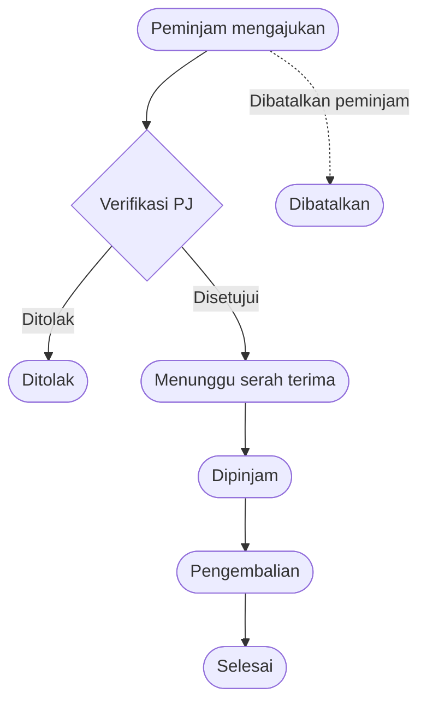

# SIPAS

<div align="center">

### Sistem Informasi Peminjaman Alat Sekolah

Aplikasi web untuk mengelola peminjaman alat dan perlengkapan sekolah — dari katalog dan pengajuan, hingga persetujuan, serah terima, pengembalian, serta perhitungan denda.


</div>

---

## Tentang SIPAS

**SIPAS** (Sistem Informasi Peminjaman Alat Sekolah) merupakan aplikasi berbasis web yang membantu sekolah mengelola inventaris dan proses peminjaman alat secara terstruktur.

Aplikasi ini menyediakan akses untuk dua kelompok pengguna utama: **peminjam** (siswa dan guru) serta **admin/penanggung jawab (PJ)** untuk setiap kategori alat.

Data contoh bawaan menggunakan konteks SMKN 5 Solo, dengan kategori Bengkel, Lab RPL, Multimedia, dan Olahraga.

## Fitur

### 👤 Peminjam — Siswa & Guru

- Pendaftaran akun siswa menggunakan NISN dan kelas, serta akun guru menggunakan NIP dan mata pelajaran/unit kerja.
- Katalog alat berdasarkan kategori, dilengkapi stok, spesifikasi, lokasi, batas hari peminjaman, dan denda per hari.
- Pengajuan peminjaman dengan nomor tiket dan unggah proposal.
- Melihat riwayat, membatalkan pengajuan, serta mencetak bukti peminjaman dan riwayat.
- Kotak pesan untuk menerima notifikasi dari PJ.
- Melihat profil PJ pada setiap kategori.

### 🛠️ Admin — Penanggung Jawab (PJ)

- Memverifikasi pengajuan: menyetujui atau menolak peminjaman.
- Mengelola proses serah terima dan penyelesaian pengembalian.
- Mengirim pesan kepada peminjam terkait pengajuan.
- Mengelola alat dan unit fisik, termasuk kode unit, status, dan kondisi.
- Mencetak bukti peminjaman dan rekap peminjaman.
- Mengirim pesan kepada pengguna melalui pusat pesan.

### ⚙️ Otomatisasi

- Menghitung denda keterlambatan.
- Mengirim pengingat kepada peminjam melalui perintah terjadwal `loans:process-overdue` (setiap hari pukul 07.00).

## Alur Peminjaman



Status utama peminjaman: `menunggu` → `disetujui` → `dipinjam` → `selesai`, dengan status tambahan `ditolak` dan `dibatalkan`.

## Teknologi

| Bagian | Teknologi |
| --- | --- |
| Backend | PHP 8.3+, Laravel 13 |
| Frontend | Blade, Tailwind CSS 4, Vite |
| Database | SQLite (default pada `.env.example`), MySQL didukung oleh image Docker |
| Antrean, cache, sesi | Database driver |
| Testing | PHPUnit |
| Code style | Laravel Pint |

## Persyaratan

Pastikan perangkat pengembangan sudah memiliki:

- PHP 8.3 atau lebih baru beserta ekstensi Laravel yang diperlukan (`pdo`, `mbstring`, `gd`, `zip`, `intl`, dan lainnya).
- Composer 2.
- Node.js dan npm.

> Proyek ini dikembangkan menggunakan PHP 8.5. Image Docker untuk deployment Railway menggunakan PHP 8.4.

## Instalasi

1. Clone repositori dan masuk ke direktori proyek:

   ```bash
   git clone https://github.com/karanglawud/SIPAS.git
   cd SIPAS
   ```

2. Jalankan setup:

   ```bash
   composer run setup
   ```

   Perintah tersebut menjalankan instalasi dependency, menyalin `.env.example` menjadi `.env`, membuat `APP_KEY`, menjalankan migrasi, serta memasang dan membangun asset frontend.

3. Jika menggunakan SQLite dan file database belum tersedia, buat file database lalu jalankan migrasi:

   ```bash
   touch database/database.sqlite
   php artisan migrate
   ```

4. (Opsional) Isi database dengan data contoh:

   ```bash
   php artisan db:seed
   ```

5. Buat symbolic link agar gambar dan proposal yang diunggah dapat diakses:

   ```bash
   php artisan storage:link
   ```

## Menjalankan Aplikasi

Jalankan aplikasi menggunakan:

```bash
composer run dev
```

Aplikasi dapat diakses melalui **http://localhost:8000**.

Alternatifnya, jalankan `php artisan serve` dan `npm run dev` pada dua terminal terpisah.

### Scheduler

Agar perhitungan denda dan pengingat otomatis berjalan, aktifkan scheduler Laravel:

```bash
php artisan schedule:work
```

Untuk menjalankan proses tersebut secara manual satu kali:

```bash
php artisan loans:process-overdue
```

## Akun Demo

Setelah menjalankan `php artisan db:seed`, akun berikut dapat digunakan. Semua akun demo menggunakan password **`password`**.

| Peran | Email |
| --- | --- |
| Siswa | `abror@smkn5solo.sch.id` |
| Guru | `danang@smkn5solo.sch.id` |
| Admin — Bengkel | `pj.bengkel@smkn5solo.sch.id` |
| Admin — Lab RPL | `pj.lab@smkn5solo.sch.id` |
| Admin — Multimedia | `pj.multimedia@smkn5solo.sch.id` |
| Admin — Olahraga | `pj.olahraga@smkn5solo.sch.id` |

> **Penting:** Jangan jalankan seeder di lingkungan produksi. Ganti seluruh kredensial bawaan sebelum aplikasi digunakan secara publik.

## Testing & Code Style

Jalankan pengujian:

```bash
composer test
```

Periksa dan rapikan code style menggunakan Laravel Pint:

```bash
vendor/bin/pint
```

## Struktur Proyek

```text
app/
├── Console/Commands/    # Perintah Artisan, termasuk loans:process-overdue
├── Http/Controllers/    # Controller peminjam dan admin
└── Models/              # User, Category, Tool, ToolUnit, Loan, Message

database/
├── migrations/          # Skema database
└── seeders/             # Data contoh

resources/views/          # Tampilan Blade
routes/
├── web.php               # Definisi route web
└── console.php           # Jadwal perintah Artisan

tests/Feature/            # Pengujian fitur
```

## Deployment

Repositori menyediakan `Dockerfile` dan `start.sh` untuk deployment berbasis container (disiapkan untuk Railway).

Saat container dijalankan, skrip akan menyiapkan direktori storage, membangun cache produksi, menjalankan migrasi dengan `php artisan migrate --force`, lalu memulai server pada port dari environment variable `PORT` (default: `8080`).

Hal yang perlu diperhatikan:

- Atur `APP_ENV=production`, `APP_DEBUG=false`, dan `APP_KEY` melalui environment variable.
- Gunakan persistent volume untuk direktori `storage/` agar file unggahan tidak hilang.
- Pastikan Laravel Scheduler berjalan, misalnya melalui cron dengan `schedule:run` atau proses `schedule:work`, agar denda dan pengingat diproses.

## Kontribusi

Kontribusi dan saran pengembangan sangat terbuka. Untuk mulai berkontribusi:

1. Fork repositori ini.
2. Buat branch baru: `git checkout -b fitur/nama-fitur`.
3. Pastikan pengujian berjalan dengan `composer test`.
4. Rapikan code style menggunakan `vendor/bin/pint`.
5. Commit perubahan dan buat Pull Request.

## Lisensi

Repositori ini belum menyertakan file lisensi. Laravel sendiri didistribusikan di bawah [lisensi MIT](https://opensource.org/licenses/MIT).
